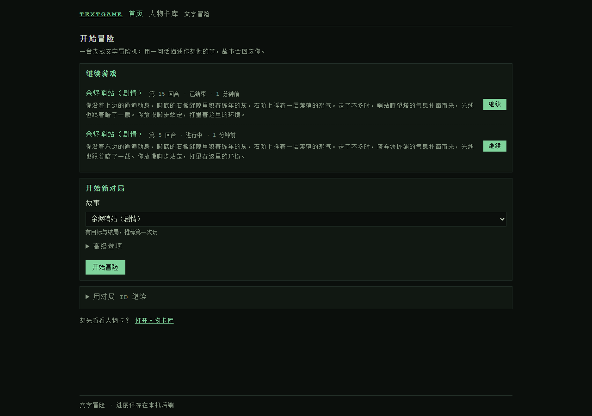
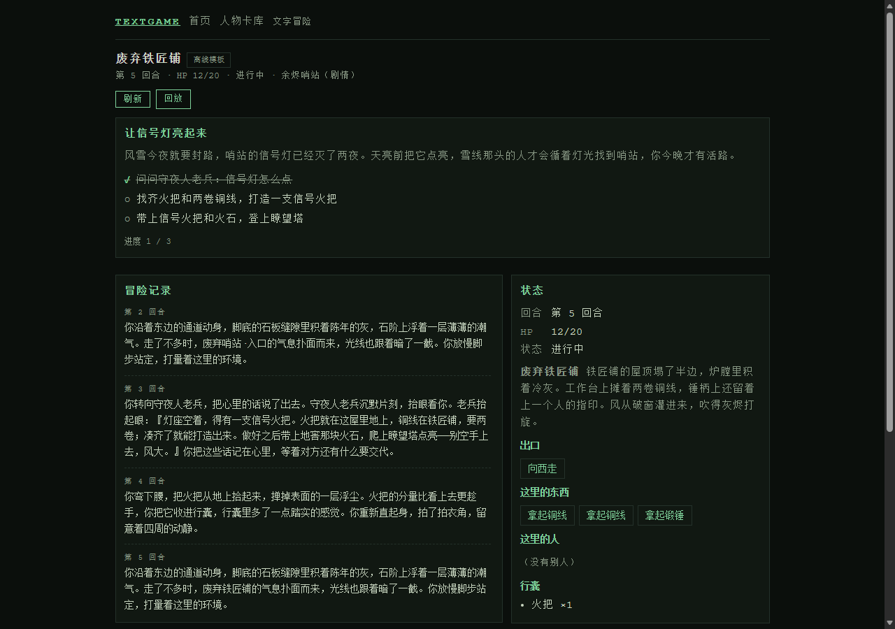
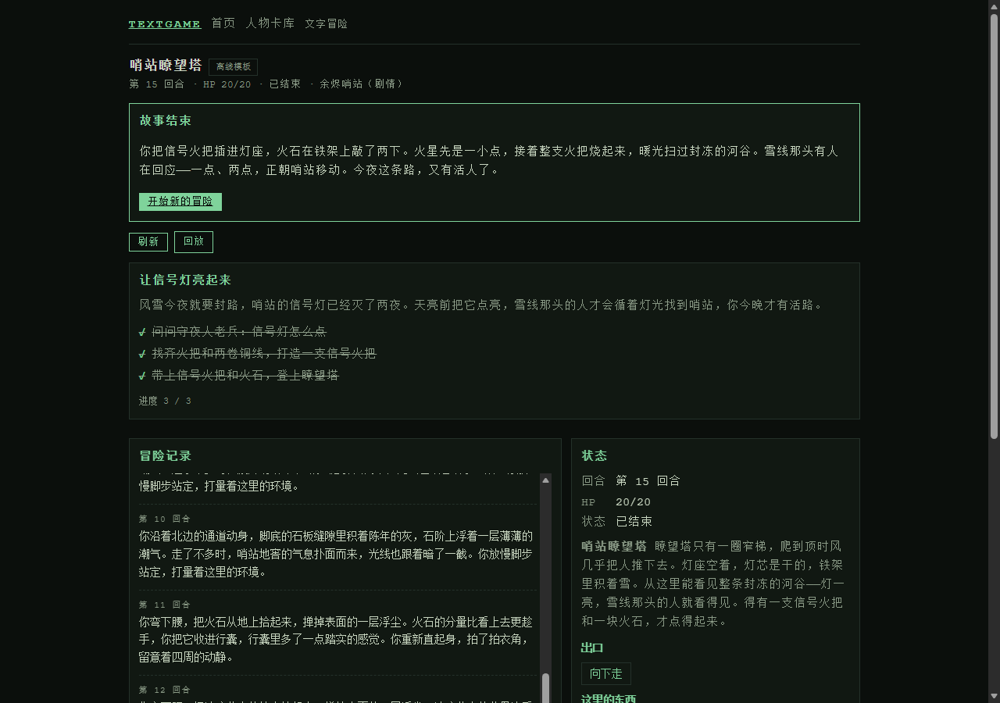
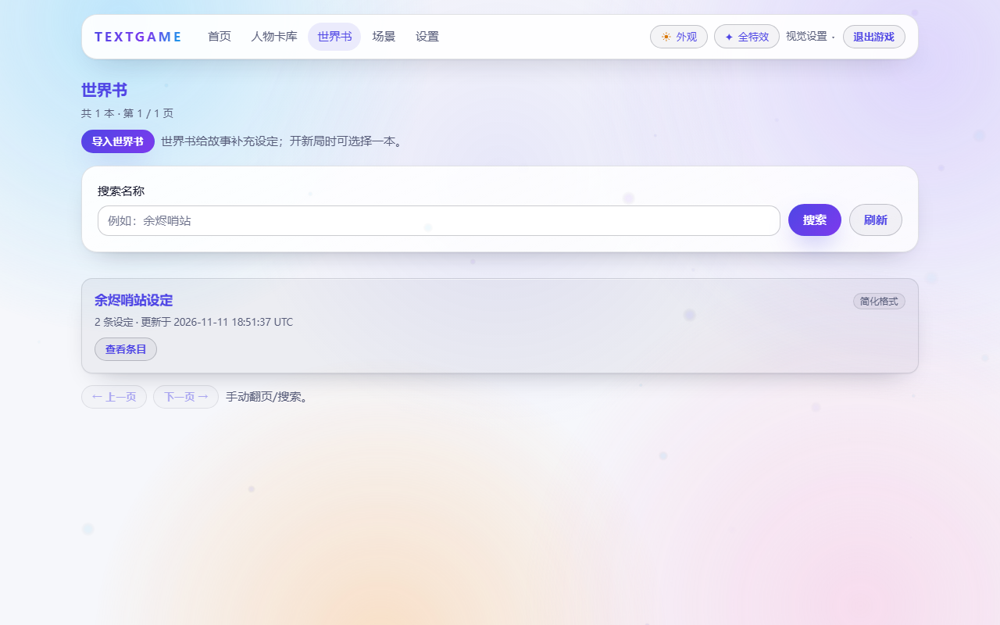
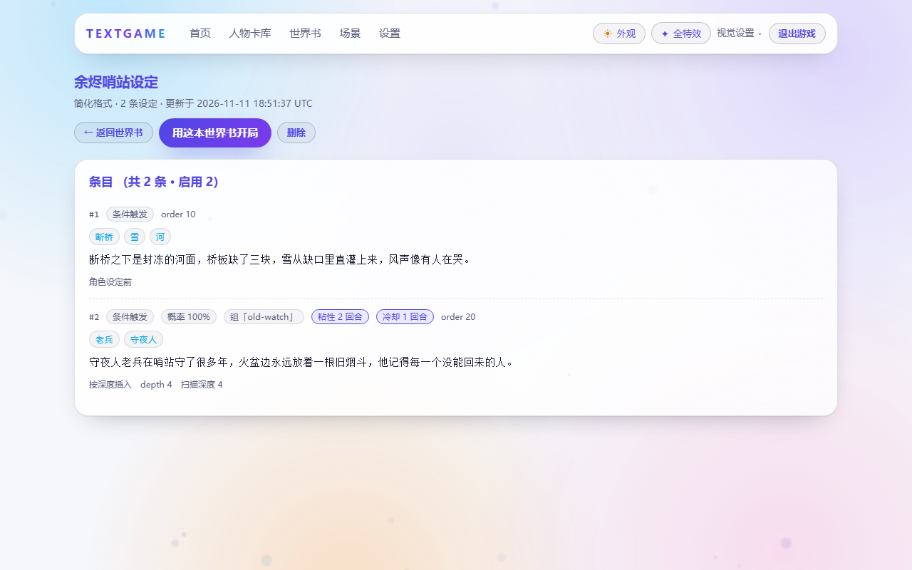
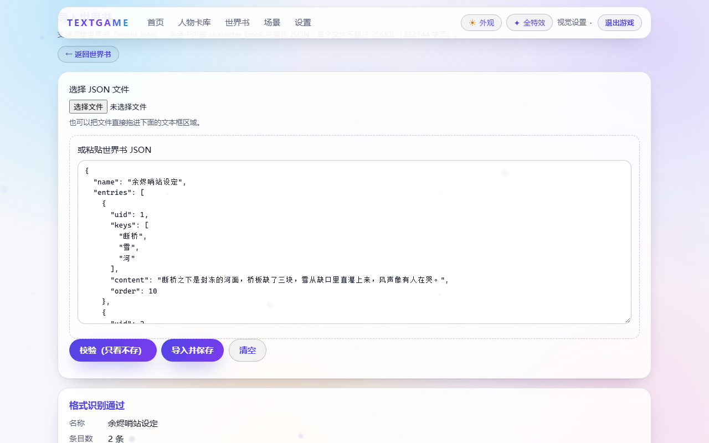
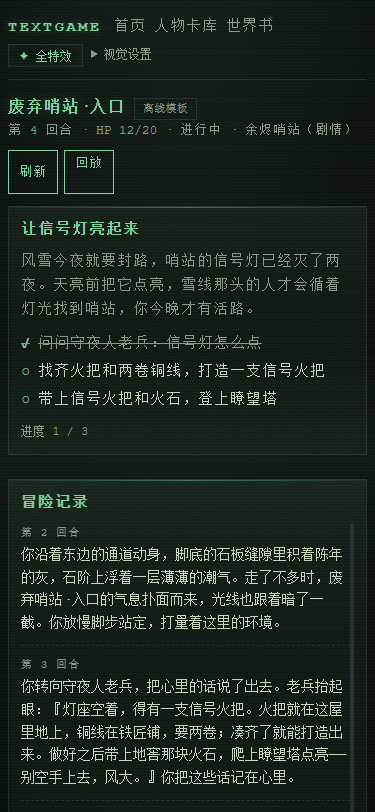

# 文字交互游戏 · Text Interactive Game

[](https://github.com/bd-lo/text-interactive-game/actions/workflows/ci.yml)

单机 / 异步文字冒险游戏。玩家用自然语言输入行动，LLM Agent 负责理解意图与叙事包装，规则引擎负责一切确定性计算与状态提交。

**默认离线可玩**：不需要 API Key、不需要 Node/pnpm、不需要联网（仅首次安装依赖需联网）。

> **当前状态**：`0.3.0`（2026-11-11，玩家启动器/退出体验批次）。M1–M6 已完成；**UC 批次**已交付——**玩家自上传场景 JSON**（网页场景库导入即玩/终端 `--scenario-id`）、**酒馆级世界书**（正则键/定时效果/包含组/position-depth 排序，兼容 SillyTavern World Info 与 Character Card V2 `character_book`）、**自己的 DeepSeek API Key**（网页设置页输入，本地开发默认用 `.env` 开发 key，干净克隆引导输入，保存即生效；默认离线仍可玩）。**WB2** 补齐世界书详情字段可见性；**M6 后计划表**已定案（第 17 章 §17.9：N1 内容 / N2 体验 / N3 功能 / N4 技术发布 / N5 发布体验 五轨道，编号 029–060）；**057 玩家启动器**——Windows 双击 `启动游戏.bat` 启动（启动器窗口 + 浏览器），游戏内「退出游戏」优雅退出，关浏览器 5 分钟空闲自动退出，`退出游戏.bat` 兜底。
> 里程碑与逐切片证据见 [docs/PROGRESS.md](docs/PROGRESS.md)、[057 启动器进度文档](docs/progress/057-2026-11-11-player-launcher.md)、[WB2 进度文档](docs/progress/WB2-2026-11-11-worldbook-detail-fields.md) 与 [UC 进度文档](docs/progress/UC-2026-11-11-user-content-and-llm.md)（当前实测：pytest **2186 passed** / replay 68 / web **56 files/347 tests** / 浏览器 e2e **26 步/125 断言**（+启动器模式 26/126）；数字以 CI 与实际输出为准）。
> 发布与分发：[CHANGELOG](CHANGELOG.md)、[RELEASE.md](RELEASE.md)（版本号/checklist/tag 流程）、[部署与分发评估](docs/design/deployment-and-distribution.md)（双击启动器 / wheel 为主，Docker 暂不提供）。
> 本批设计文档：[用户场景 JSON 格式与设计](docs/design/user-scenario-modules.md)、[世界书格式兼容](docs/design/world-book-format-compat.md)、[ADR D-UC/D-LLM/D-WB](docs/decisions/2026-11-11-user-content-and-llm-runtime.md)、[M6 后计划表 ADR](docs/decisions/2026-11-11-post-m6-roadmap.md)、[Aurora Glass 双皮肤 ADR（D-UI-3）](docs/decisions/2026-11-11-aurora-glass-theme.md)、[视觉参考与许可证](docs/design/frontend-visual-refs.md)、[技术风险审查与修复记录（R-01～R-25）](docs/audits/2026-11-11-technical-pitfalls-review.md)、[跑团式世界模组（设计）](docs/design/trpg-world-module.md)、[LLM 参与与自由度评估审计（2026-11-12）](docs/audits/2026-11-12-llm-participation-freedom.md)。



| 对局：目标面板 / 冒险记录 / 世界设定 / 可点建议 | 剧情结局屏（光晕收束） |
| --- | --- |
|  |  |

| 世界书列表 | 世界书详情（条目表：触发词/概率/包含组/定时效果/position-depth） | 世界书导入（错误/警告可视化） |
| --- | --- | --- |
|  |  |  |

> 手机 375px 单列布局：

## 快速开始

| 前置 | 什么时候需要 |
| --- | --- |
| [uv](https://github.com/astral-sh/uv) | **必需**（Python 3.12 由 uv 自动下载管理） |
| Node 24/26 + pnpm 12.6 | 只有「修改前端源码/重新构建网页产物」时需要；玩游戏不需要 |
| DeepSeek API Key | 只有「开启真实 LLM 叙事」时需要；默认离线不需要 |

### Windows 普通玩家：双击 `启动游戏.bat`（推荐）

只想玩、不想碰命令行的话，用启动器：

1. 双击仓库根目录的 **`启动游戏.bat`** → 出现「文字交互游戏」启动器小窗口（首次运行会自动安装运行依赖，需要联网，可能几分钟）；
2. 就绪后自动用默认浏览器打开游戏页面（`http://127.0.0.1:8000`）；
3. 退出方式（任选其一）：
   - 在游戏页面点 **「退出游戏」**（正常退出，进度已保存）；
   - 关闭启动器小窗口（等同于结束游戏进程）；
   - 兜底：双击根目录 **`退出游戏.bat`**——按端口精确找到游戏进程并结束（可带端口参数，如 `退出游戏.bat 8001`）；没有在运行时会提示「游戏没有在运行」；
   - 只关掉浏览器**不算**退出：页面心跳停止 5 分钟后，启动器会自动退出并释放端口（存档实时保存，下次启动自动继续）。
4. 启动日志在 `data/logs/launcher-server.log`（追加写入，含失败原因）；存档仍在 `data/textgame.db`。

> 前置仍是 [uv](https://github.com/astral-sh/uv)（唯一必需前置）。缺少 uv 时启动器会弹窗给出安装网址
> <https://docs.astral.sh/uv/getting-started/installation/>，安装完成后重新双击即可。
> 非 Windows / 无图形环境：`./scripts/play.sh --launcher` 或 `pwsh -File scripts/play.ps1 -Launcher` 会自动降级为控制台模式（同样打印启动/退出提示）。
> 启动器自检（无窗口、无浏览器）：`.\scripts\play.ps1 -LauncherCheck` / `./scripts/play.sh --launcher-check`。

### 网页版（命令行方式）

仓库**已包含预构建的网页产物 `web/dist`**，克隆后无需 Node/pnpm：

```powershell
git clone https://github.com/bd-lo/text-interactive-game.git
cd text-interactive-game
.\scripts\play.ps1
# → 浏览器打开 http://127.0.0.1:8000（按 Ctrl+C 停止）
```

```bash
git clone https://github.com/bd-lo/text-interactive-game.git
cd text-interactive-game
./scripts/play.sh
# → http://127.0.0.1:8000
```

- `-Port 8001` / `--port 8001`：换端口；`-Llm` / `--llm`：启用真实 LLM 叙事（需 Key，见 FAQ）。
- 自检（启动服务 → 校验 `/healthz` 与 `/` 均 200 → 退出）：`.\scripts\play.ps1 -Check`（bash：`./scripts/play.sh --check`）。
- 普通玩家启动器（与双击 `启动游戏.bat` 等价）：`.\scripts\play.ps1 -Launcher`（bash：`./scripts/play.sh --launcher`）；启动器控制面自检：`.\scripts\play.ps1 -LauncherCheck` / `./scripts/play.sh --launcher-check`（headless，校验状态/心跳/退出接口与进程退出、端口释放）。
- 首页可直接选场景与世界书；**推荐首玩「余烬哨站」剧情（story，有目标与结局）**，其它为 m2 单场景 / m3 多角色 / m4 制造。
- 右上角 **✦ 视觉效果**：全特效 / 低功耗 / 关闭特效三档（本机持久化；系统开启「减少动态效果」时自动降级）。
- 想改前端：`pnpm --dir web install --frozen-lockfile && pnpm --dir web build` 后重新运行 `play` 脚本（详见 [web/README.md](web/README.md)）。

### 终端版

```powershell
.\scripts\play.ps1 -Terminal     # 或旧的 .\scripts\quickstart.ps1
```

```bash
./scripts/play.sh --terminal     # 或旧的 ./scripts/quickstart.sh
```

进入终端后直接输入自然语言（如 `环顾四周`、`拿起火把`、`向北走进地窖`），每回合 80–150 字叙事 + 一行状态（HP/位置/行囊）；`:help` 看命令，`:inv` 看行囊，`:status` 看状态，`:quit` 退出。存档默认写入 `data/textgame.db`（已 gitignore）。

**推荐从剧情开局**（有目标/结局，终端同样支持）：

```bash
uv run --no-dev python -m textgame.console --new --scenario story   # 「余烬哨站」剧情
uv run --no-dev python -m textgame.console --list                   # 列出最近存档
```

也可以用底层命令直接玩：

```bash
uv sync --frozen --no-dev                      # 仅运行时依赖（首次联网）
uv run --no-dev python -m textgame.console     # 终端版
uv run --no-dev uvicorn textgame.main:app --port 8000   # 网页版（仓库根执行）
```

想先看固定 seed 的 7 屏演示而不进入交互：`uv run python -m textgame.demo`（实际输出见 [examples/m2-demo.md](examples/m2-demo.md)）；自动验收：`uv run python -m textgame.demo --check` 与 `uv run python -m textgame.console --check`。

进入交互后的第一屏（seed=42，逐字可复现；完整 7 屏见 [examples/m2-demo.md](examples/m2-demo.md)）：

```text
废弃哨站·入口。废弃哨站的入口塌了一半，风从断裂的门楣间穿过，卷起细碎的石屑。墙角堆着受潮的木箱，地上散落着几件被遗弃的杂物。地上有火把、治疗药水。这里站着老哨兵。可以往北走。你把眼前的景象在心里过了一遍，留意着可能变化的角落。
【状态】HP 20/20 ｜ 位置 废弃哨站·入口 ｜ 行囊：空
```

## 版本与发布

- **当前版本 `0.3.0`**（2026-11-11，玩家启动器/退出体验 = N5 057）。版本号唯一来源：
  `pyproject.toml` 与 `src/textgame/__init__.py::__version__`；玩家可见变更见 [CHANGELOG.md](CHANGELOG.md)。
- **怎么发**：[RELEASE.md](RELEASE.md) 给出发布 checklist（测试/四门/e2e/构建冒烟/启动器冒烟/许可证/安全/文档）、
  wheel 干净环境冒烟命令与 `git tag` / Release notes 流程。上一发布快照 **`v0.2.0`** 已打注记 tag
  （2026-11-11，CI run `43032265398` 全绿）；`0.3.0` 已 push main，tag 与 GitHub Release 待维护者决定。
- **分发形态**：Windows 普通玩家默认「双击 `启动游戏.bat` 启动器」（底层 `scripts/play.ps1 -Launcher`）；开发者可「仓库克隆 + `play` 脚本」（已含 `web/dist`，无需 Node）或 wheel（内嵌网页版）；
  Docker 评估结论是**暂不提供镜像**（草案与复评条件见[部署与分发评估](docs/design/deployment-and-distribution.md)）；
  PyPI 正式发布暂缓（由维护者拍板）。
- **版本路线**：后续能力按 [第 17 章 §17.9 M6 后计划表](docs/开发文档/第17章-里程碑与进度文档编号规划.md)
  的五条轨道推进（N1 内容 / N2 体验 / N3 功能 / N4 技术发布 / N5 发布体验，编号 029–060）。

## 世界书（World Book / Lorebook）

世界书是**只读的设定注入层**：命中触发词时把设定文本交给叙事（模板叙事追加 1–2 句 / LLM 作为「世界设定事实」），
**不写游戏状态、不改事件、不影响旧存档与回放**。UI 为自研「炫技缝合」风格，**不参考 SillyTavern 界面**。

- **兼容格式**（导入自动识别，≤256KB）：
  1. SillyTavern World Info 导出 JSON（`{"entries": {...}}` / 条目数组 / 裸 map）；
  2. Character Card V2 的 `data.character_book`（与人物卡一起导入时自动识别，来源标记 `character_card`）；
  3. 本项目简化 schema（`{"name","description","entries":[...]}`）。
  字段兼容矩阵与语义差异（含未实现字段清单）见 [docs/design/world-book-format-compat.md](docs/design/world-book-format-compat.md)。
- **触发语义（确定性可回放）**：`keys`（大小写不敏感子串）/`keysecondary` + `selectiveLogic`
  （AND_ANY/NOT_ALL/NOT_ANY/AND_ALL）/`constant`/`order`/`scanDepth`（默认最近 4 条上下文）/递归 ≤2 轮 /
  预算 800 字 / 最多 8 条；`probability` 用 `sha256(save_seed:turn_id:uid:…)` 确定性伪随机。
  **酒馆级语义（UC 起支持）**：正则键（`/pattern/flags`，仅 i/m/s）、定时效果（`sticky/cooldown/delay`，
  按事件历史逐回合模拟）、包含组（`group/groupWeight/groupOverride`，同组每回合至多 1 条）、
  `position/depth` 排序；这些字段的**配置值在详情页可见**（WB2）。仍未支持：`vectorized` 向量检索、
  `outlet` 宏插入、`characterFilter`、`useGroupScoring` 评分（保留原始 JSON 并给 warning，不静默丢弃）。
- **怎么玩**：网页版「世界书」页 → 导入 JSON → 首页「新建对局」选择世界书 + 场景 → 对局右侧「世界设定」面板显示本回合激活条目。
  示例（`story` 场景「余烬哨站」配套）：[examples/world-books/story-lorebook.json](examples/world-books/story-lorebook.json)（**29 条** tavern 格式）、
  [examples/world-books/story-character-card.json](examples/world-books/story-character-card.json)（角色卡 V2 + 内嵌 4 条）、使用说明见 [examples/world-books/README.md](examples/world-books/README.md)。
- **API**（写操作带 `Idempotency-Key`；导入 ≤256KB，非法 JSON/格式不支持 422，过大 413，幂等冲突 409，未知 id 404，删除为软删）：
  ```bash
  curl --noproxy '*' -X POST http://127.0.0.1:8000/api/v1/world-books/import \
    -H 'Idempotency-Key: demo-wb-0001' -F 'file=@examples/world-books/story-lorebook.json'
  # → 201 {"world_book_id","name","entry_count","source","warnings":[...]}
  curl --noproxy '*' 'http://127.0.0.1:8000/api/v1/world-books?query=哨站&limit=20&offset=0'   # 列表（分页/搜索）
  curl --noproxy '*' http://127.0.0.1:8000/api/v1/world-books/{world_book_id}                    # 详情 + 条目
  ```
  `POST /api/v1/games` 加法 body `{"world_book_id": "wb_..."}` 绑定开局；`GET /api/v1/games/{id}/view` 加法
  `world_book`（摘要）与 `lore.active_entries`（本回合激活条目）。
- **兼容性**：无世界书的旧存档照常可玩（`/view.world_book` 与 `lore` 为 null），旧 golden/回放零影响。
- **限制**：不执行任何来自导入内容的脚本/命令；`vectorized` 向量检索、`outlet` 宏插入、`characterFilter`
  仍不支持（见兼容文档 §5）；世界书详情页只展示配置值，「本回合是否激活」看对局内「世界设定」面板。

## 玩家自上传场景（Scenario JSON）

剧情不再固定：**玩家自己上传一份场景 JSON 就能开新局**（不需要改代码、也不需要等我们更新内容）。

- **怎么玩**：网页「场景库」(`/scenarios`) → 导入/粘贴 JSON → 校验预览（错误逐条给 JSON 路径）→ 导入 →
  「按此场景开局」；首页「新建对局」的场景下拉同时列出内置 4 个场景与已上传场景。
  终端：`--list-scenarios` 查看已上传场景、`--scenario-id <ID>` 直接开局。
- **格式**：`schema_version/slug/meta/player/rooms/items/npcs/goal/endings/suggestions`，条件 DSL 只认白名单谓词
  （`in_room/has_item/has_item_tag/npc_state/hp_lte/hp_gte` + `all/any/not/always`，禁 eval）。完整字段、限额、
  作者向最小示例见 [docs/design/user-scenario-modules.md](docs/design/user-scenario-modules.md) §2。
- **示例**（可直接导入试玩）：
  [examples/scenarios/tiny-tower.json](examples/scenarios/tiny-tower.json)（两房间最小场景）、
  [examples/scenarios/ember-watch.json](examples/scenarios/ember-watch.json)（5 房间/守夜人对话/枯井进入伤害/胜利+倒下双结局）。
- **支持的内容**：房间与出口、物品（`heal`/`hp_delta` 等既有道具效果）、NPC 关键词对话（可写 `dialogue_state` 供目标判定）、
  目标链（条件满足即完成）、显式结局（按 `priority` 取第一个满足项，未写时按「目标全完成=胜利 / HP≤0=倒下」兜底）、
  进入房间伤害、建议文案。**不支持**自定义配方/制造链、战斗系统、脚本表达式、GM 层/多人——边界见设计文档 §4。
- **确定性**：场景实体内 ID 由 `sha256(scenario_id|kind|key)` 派生（同 JSON 同存档状态可复算），
  目标/结局读时纯求值，不新增 `EventType`、不写 `GameState` 字段；旧 4 场景 golden/回放零影响。
- **API**（写操作带 `Idempotency-Key`；导入 ≤256KB，非法 JSON/字段给结构化 errors，过大 413，未知 id 404）：
  ```bash
  curl --noproxy '*' -X POST http://127.0.0.1:8000/api/v1/scenarios/validate \
    -H 'Content-Type: application/json' --data-binary @examples/scenarios/ember-watch.json   # 只读预检
  curl --noproxy '*' -X POST http://127.0.0.1:8000/api/v1/scenarios \
    -H 'Idempotency-Key: demo-scn-0001' -H 'Content-Type: application/json' \
    --data-binary @examples/scenarios/ember-watch.json                                        # → 201 {scenario_id,...}
  curl --noproxy '*' -X POST http://127.0.0.1:8000/api/v1/games \
    -H 'Content-Type: application/json' -H 'Idempotency-Key: demo-scn-game-0001' \
    -d '{"scenario_id":"scn_..."}'                                                           # 按上传场景开局
  ```

## 自己的 DeepSeek API Key（设置页）

- **本地开发机**：把 `.env` 里的 `TEXTGAME_LLM_API_KEY` 填上（见 [.env.example](.env.example)），启动后**自动使用开发 key**，
  不需要任何额外输入；`TEXTGAME_LLM_ENABLED=false` 可显式关闭（永远离线）。
- **干净克隆 / 玩家机器**：没有 `.env` 时默认**离线模板叙事，仍然可玩**；首页会出现「未配置大模型」横幅 →
  进入「设置」页填自己的 DeepSeek API Key → **保存后当回合生效**（无需重启）。
- 设置页还支持：测试连接（返回延迟/中文失败原因）、清除本机 key、查看当前来源（开发环境 / 本机保存 / 未配置）与打码 key。
- 存储与安全：key 只保存在本机 `data/llm.credentials.json`（已 gitignore；可用 `TEXTGAME_LLM_CREDENTIALS_FILE` 改路径），
  不写数据库、不进日志、接口只回打码值；`.env` 开发 key 永远优先于本机保存的 key。
- **自由制造开关**：配置 key 后，设置页可开启「自由制造」——不命中固定配方时让大模型临时生成草稿。
  开启前需确认“裁决/重试链路内调 LLM、可能重复计费”；确认后立即生效，偏好保存在 `data/free_craft.json`
  （`TEXTGAME_FREE_CRAFT_SETTINGS_FILE` 可改路径），重启保留。只建议单人本地使用。

## 常见问题（FAQ）

- **PowerShell 报「无法加载文件 … 未对文件进行数字签名」/ 执行策略**：用 `powershell -ExecutionPolicy Bypass -File .\scripts\play.ps1` 或 `pwsh -File .\scripts\play.ps1`。仓库脚本已按 **UTF-8 with BOM** 保存，Windows PowerShell 5.1 与 PowerShell 7 都能正确解析中文。
- **Windows + 中文仓库路径**：支持（本机开发路径即 `D:\ProgramData\游戏开发`）。历史注意点：Python 3.10 下 editable 安装的 `.pth` 会被 GBK `site.py` 读取失败；本地验 3.10 用 `uv sync --frozen --python 3.10 --no-editable` + `PYTHONPATH=src`（CI 的 ubuntu/UTF-8 不受影响）。`pre-commit install` 生成的 hook 在 Git Bash 下可能找不到 `pre-commit`，用 `uv run pre-commit run --all-files` 手动跑。
- **第一次运行为什么慢**：`uv sync` 会下载 CPython 3.12 与 `uv.lock` 锁定依赖（运行时约 98 个包、数百 MB 磁盘）；已同步过的环境之后秒级启动。只玩终端/网页用 `--no-dev` 更快；跑测试/质量门才需要 dev 依赖。
- **怎么退出游戏？** 推荐在游戏页面点 **「退出游戏」**（正常退出，进度已保存）；也可以关闭启动器小窗口，或双击根目录 **`退出游戏.bat`** 兜底（按端口精确结束后台进程，可带端口 `退出游戏.bat 8001`；没运行时提示「游戏没有在运行」）。只关掉浏览器不算退出：5 分钟没有页面心跳后启动器会自动退出（`TEXTGAME_IDLE_EXIT_SECONDS` 默认 300；0=关闭自动退出）。命令行方式直接按 Ctrl+C 停止服务。
- **双击 `启动游戏.bat` 后一直显示「正在准备…（首次运行需几分钟）」？** 首次运行要先下载 CPython 3.12 与运行时依赖（数百 MB，取决于网络），请耐心等窗口状态变为「游戏运行中」；进度/失败原因看 `data/logs/launcher-server.log`。缺少 uv 时启动器会弹窗直接给出安装网址，安装后重新双击即可（不会自动安装任何东西）。
- **有安装包 / 免安装 exe 吗？** 暂不提供（2026-11-11 评估：需新增构建链与发布流水线、包体较大且有杀软误报/签名成本，当前「双击 `启动游戏.bat` + uv」已满足单机试玩；如后续有需求再单独立项评估）。
- **存档在哪里**：默认 `data/textgame.db`（已 gitignore，不会误提交）；终端版默认自动继续同库最近存档，`--new` 强制新开、`--continue` 强制继续；`--db <路径>` 或 `--db sqlite:///…` 可指定别处。
- **怎么开真实 LLM 叙事（可选）**：本地开发机把 [.env.example](.env.example) 复制为 `.env` 并填 `TEXTGAME_LLM_API_KEY`
  即可自动启用（或用 `.\scripts\play.ps1 -Llm`）；干净克隆的玩家在自己浏览器里打开「设置」页填入 DeepSeek API Key，
  保存后当回合生效。连通性自检：`uv run python -m textgame.llm.smoke`（缺 Key 退出码 2，API 失败退出码 1）。
  **默认离线可玩**，不配置就一直离线且零联网。
- **上传的场景 JSON 报错了怎么看？** 导入页会先调 `POST /api/v1/scenarios/validate` 做只读预检：`errors` 逐条给
  JSON 路径（如 `rooms[2].exits.east`）与中文原因；`warnings` 只提示不阻断（例如物品永远拿不到、NPC 没写对话）。
  先用 [examples/scenarios/tiny-tower.json](examples/scenarios/tiny-tower.json) 验证格式，再逐步加内容。
- **保存了 API Key 为什么还是模板叙事？** 先看「设置」页状态卡：`source=env` 表示 `.env` 开发 key 优先（本机保存的 key 不生效）；
  `TEXTGAME_LLM_ENABLED=false` 时永远离线。另外自检/演示命令（`demo/console --check`）会强制离线以保证 golden 逐字可复现。
- **世界书导入了但没触发？** 检查条目 `enabled`、`constant`、`keys` 是否出现在最近 `scanDepth` 条上下文/当前房间/可见实体/本回合输入中；看导入返回的 `warnings`（未支持字段会被忽略）；`group`/`sticky/cooldown/delay`/正则键已在 UC 起支持（配置值可在详情页看到），`vectorized`/`outlet` 仍不支持（见兼容文档）。先用「简化 schema」最小 JSON 验证格式。
- **特效太晃/卡顿？** 右上角 **✦ 视觉效果** 选「低功耗」或「关闭特效」（持久化）；系统开启「减少动态效果」会自动降级；特效层懒加载，不影响首屏可读性。
- **端口被占用 / 网页打不开**：`play` 脚本会提示换端口（`-Port 8001` / `--port 8001`）。若 `/` 返回 JSON 404，通常是 `web/dist` 缺失（源码裁剪或未构建）：启动日志会有 WARNING，按 README「网页版」里的构建命令重建即可；终端版始终可用。
- **浏览器要求**：现代 Chromium/Firefox/Safari（支持 CSS 自定义属性、`prefers-reduced-motion`）；无 JS 时不可用（SPA）。在线文档：服务启动后 `/api/docs`。
- **数据与隐私**：默认离线路径不联网；`.env`、`data/`、`*.db` 均被 gitignore，不提交密钥与存档；世界书内容仅本机存储。

## 玩法与场景

- 自然语言输入 + 少量本地命令（`:help/:look/:inv/:status/:quit`）；回合失败会给出可重试提示与建议动作。
- 场景选择：**`story`（余烬哨站剧情，有目标与结局，推荐首玩）** / `m2`（单场景，默认，保持旧契约）/ `m3`（多角色：两名拾荒者同回合抢同一瓶药水）/ `m4`（制造：配方与自由制造校验）；**更多剧情由玩家自己上传场景 JSON**（见上文「玩家自上传场景」）。
  ```bash
  uv run --no-dev python -m textgame.console --new --scenario story
  uv run --no-dev python -m textgame.console --list-scenarios          # 查看已上传场景
  uv run --no-dev python -m textgame.console --scenario-id scn_...     # 按上传场景开局
  ```
- **AI 叙事（可选）**：在网页「设置」页填自己的 DeepSeek API Key（本地开发机直接读 `.env` 开发 key），
  保存后即时生效；不配也完全可玩（模板叙事 + 确定性规则）。
- 剧情场景首屏会显示目标与子目标完成态（如「【目标】让信号灯亮起来 · 0/3」）；走到结局时打印结局屏，输入 `:quit` 退出。终端 `--list` 可查看同库最近存档（含场景/回合/是否已结局）。
- **剧情失败结局**：枯井「寒气」每次进入 -6 HP——连续两次进井即 HP→0 触发「倒下」结局；先找药水/烈酒回血可以再挑战（失败结局同样有专属文案，不是卡死）。
- **视觉风格**：自建 **Aurora Glass** 双皮肤——日间（默认）/ 夜间，顶栏「外观」按钮一键切换（视觉设置菜单可选「跟随系统」）；极光渐变氛围 + 玻璃拟态面板 + 微光粒子 + 打字机叙事 + 面板/目标/结局动效。首帧脚本防刷新闪色，`reduced-motion`/减少透明度/无 `backdrop-filter` 均有降级，三档视觉设置（全特效/低功耗/关闭）可关；375px 可用、正文对比度 ≥4.5:1。来源与许可证见 [docs/design/frontend-visual-refs.md](docs/design/frontend-visual-refs.md)（仅 MIT 技法参考，零新增运行时依赖）。
- 网页版卡库支持**导入 JSON 人物卡**（`/cards/import`）与**生成人物卡**（`/cards/generate`：写一句人物设定 → 草稿预览 → 保存 → 按此卡开局）；**默认离线时生成结果=确定性模板草稿**（页面有显著提示），配置 LLM 后才是 LLM 生成（可选，见 FAQ）。
- HTTP API 也可以直接玩/集成：`POST /api/v1/games`（写操作必带 `Idempotency-Key`）→ `POST /api/v1/turns` → `GET /api/v1/games` / `{id}` / `/view` / `/replay`；交互式文档在服务启动后的 `/api/docs`。

<details>
<summary>HTTP 示例（创建存档 → 提交回合 → 刷新重连）</summary>

```bash
# 1) 创建存档（写操作必带 Idempotency-Key；可选 seed / scenario / world_book_id）
curl --noproxy '*' -X POST http://127.0.0.1:8000/api/v1/games \
  -H 'Content-Type: application/json' -H 'Idempotency-Key: demo-create-0001' -d '{"seed":42}'
# → 201 {"game_id":"game_...","turn":1,"version":1,"snapshot_version":1,"save_seed":"save-42"}

# 2) 提交回合（body = {game_id, input, expected_version}；expected_version 用上次返回的 version）
curl --noproxy '*' -X POST http://127.0.0.1:8000/api/v1/turns \
  -H 'Content-Type: application/json' -H 'Idempotency-Key: demo-turn-0001' \
  -d '{"game_id":"game_...","input":"环顾四周","expected_version":1}'
# → 200 TurnResult {ok, turn_id, version, text(80–150 字), events, error_code, narrative_source}

# 3) 刷新/重连
curl --noproxy '*' http://127.0.0.1:8000/api/v1/games/game_...
```

业务失败（无法理解/版本过期/幂等键冲突）返回 HTTP 200 + `TurnResult(ok=false, error_code)`；协议错误（缺 `Idempotency-Key`、body 非法）返回 4xx 统一失败信封 `{ok:false, error_code, message, violations?}`。

</details>

## 核心设计

- **拼接优先于自建**：优先复用 GitHub 上成熟的 Python 开源项目，自建部分必须有明确理由，并记录评估与取舍过程。
- **确定性计算 + 智能体生成**：数值、伤害、掉落、制造等全部在框架内确定性计算；智能体只负责理解意图、选择工具、填写参数、叙事包装。
- **OOP 领域层 + 工具白名单 + 唯一写入者 + 事件溯源**：智能体只是提议者，通过白名单工具方法操作，不直接改状态、不持有对象引用；所有写操作进入 ProposalQueue，由 Resolver 统一裁决、GameEngine 原子提交。
- **结构性防泄漏**：角色 Agent 只接收该角色的私有感知切片与私有记忆，不接收全局状态。
- **可回放**：每个写操作产生 Event（回合、调用者、方法、参数、结果、随机种子），支持固定随机种子回放与审计。
- **防幻觉 / 防越权 / 防作弊**：所有 LLM 结构化输出先过 JSON Schema 与状态一致性校验，校验失败绝不写入状态。
- **世界书=只读设定注入**：触发激活为读时纯计算（确定性种子），不写 `GameState`、不新增事件、不影响旧存档；
  格式兼容只借鉴数据类型与触发语义（SillyTavern 为 AGPL-3.0，代码零复制；其 UI 明确不参考）。
- **分发即体验**：网页构建产物随仓库入库（fresh clone 一条命令可玩），并随 wheel 内嵌（`pip install` 后同样有网页版）。

## 技术栈

| 层 | 选型 |
| --- | --- |
| 语言 | Python 3.10+（运行时 3.12，源码保持 3.10 语法兼容） |
| 环境 / 依赖锁定 | uv 0.13.x：`uv.lock` + `uv sync --frozen` |
| 领域模型 / 校验 | Pydantic v2 |
| 持久化 | SQLAlchemy 2.0.x（锁 `<2.1`）+ SQLite + Alembic（0001–0006） |
| 接入层 | FastAPI |
| 编排 | 自建显式 loop（LangGraph 仅保留可选封装） |
| 模型调用 | 统一 LLMClient 封装（DeepSeek `deepseek-flash`，默认离线） |
| Web 前端 | Vue 3 + TypeScript + Vite + Pinia + Vue Router；视觉 **零新增运行时依赖、零 UI 组件库**（自建 Aurora Glass 双皮肤 token + 原生 CSS 极光/玻璃 + Canvas2D 微光粒子 + 打字机 + 三档视觉设置） |
| 质量门 / CI | GitHub Actions：ruff + mypy + import-linter + pytest（3.10/3.12 矩阵 + 覆盖率/文档门）+ pip-licenses/pip-audit/CycloneDX + web-build（typecheck/build/vitest/**真实浏览器 e2e**） |

## 开发模式

- **vibe coding**：AI 主导编码，人类负责拆任务、给上下文、跑验收与 review；以 30–90 分钟的垂直切片迭代，每个切片必须有可运行 demo + 自动验证（lint/类型/单测/必要回放）。
- **护栏不放松**：唯一写入者 `GameEngine`、事件溯源、确定性计算与 Schema 校验、工具白名单/actor_scope、密钥与许可证决策必须人工确认。
- 详见开发文档第 17 章（开发计划）与第 22 章（轻量进度制度）。

## 本地开发环境

前置：安装 [uv](https://github.com/astral-sh/uv)；Python 3.12 由 uv 自动下载管理。本仓库**不使用**全局 Python/Anaconda 装依赖，所有命令在仓库根目录执行：

```bash
uv sync --frozen                                          # 按 uv.lock 安装 runtime + dev 依赖（首次会拉取 Python 3.12）
uv run --no-dev uvicorn textgame.main:app --reload --port 8000   # 启动服务（默认 SQLite: data/textgame.db，已 gitignore）
curl --noproxy '*' http://127.0.0.1:8000/healthz          # → 200 {"status":"ok"}
uv run ruff format --check . && uv run ruff check .        # lint / format
uv run mypy src/textgame                                   # 类型检查（strict）
uv run lint-imports                                        # 分层依赖契约
uv run pytest -q                                           # 单元 + 集成 + 回放测试（数字以实际输出为准）
uv run pre-commit install --install-hooks                  # 一次性：安装提交前质量门
```

前端（只在改 Web 时需要）：见 [web/README.md](web/README.md)。**注意**：`pnpm --dir web dev` 的 `/api` 代理目标以 `web/vite.config.ts` 为准（当前 8765；建议改为 8000 与 `play` 脚本默认端口统一，改后需重新 `pnpm --dir web build` 并提交 `web/dist`）。

真实浏览器 e2e（零依赖 CDP 驱动；先起后端，或由 CI 临时起 uvicorn）：

```bash
uv run --no-dev uvicorn textgame.main:app --port 8794 &   # 或仓库根另开终端
node scripts/e2e-web.mjs --base-url http://127.0.0.1:8794 --out artifacts/e2e-web
```

环境变量见 [.env.example](.env.example)（前缀 `TEXTGAME_`）；`.env` 不入库，禁止提交真实密钥。静态目录可用 `TEXTGAME_STATIC_DIR` 覆盖（默认自动解析 `web/dist` / 包内 `textgame/web_dist`）。

## 质量门与 CI

本地门禁（与 CI 同命令，见 [.github/workflows/ci.yml](.github/workflows/ci.yml)）：

```bash
uv run ruff format --check . && uv run ruff check .   # lint / format
uv run mypy src/textgame                              # strict 类型检查（3.10 语法）
uv run lint-imports                                   # 分层依赖契约（domain 零框架依赖）
uv run pytest -q                                      # 单元 + 集成 + 回放
uv run pre-commit run --all-files                     # 9 个 hook（含 secret-scan、EOL 规范）

# 依赖门禁
mkdir -p artifacts
uv export --frozen --no-hashes --format requirements-txt > artifacts/requirements.lock.txt
uv run pip-licenses --format=json --with-urls > artifacts/licenses.json
uv run python scripts/check_licenses.py artifacts/licenses.json   # GPL/AGPL/UNKNOWN → 阻断
uv run pip-audit -r artifacts/requirements.lock.txt                # 已知漏洞
```

CI job：`quality`（Python 3.10/3.12 矩阵：ruff → mypy → lint-imports → pytest + 覆盖率门 + 文档一致性门）、`deps`（pip-licenses/许可证门禁/pip-audit/SBOM artifact）、`web-build`（lockfile 安装 → typecheck → build → vitest → **临时 uvicorn:8794 + headless Chrome 跑 `scripts/e2e-web.mjs`**，失败上传日志）。护栏：GPL/AGPL 出现即阻断；项目自身 MIT。

**AI 上下文与网络护栏（Q9/Q10）**：仓库根 [.aiignore](.aiignore) 声明禁止进入 AI 上下文的路径（`.env*`、`.work/`、`artifacts/`、`data/`、`*.db`、`.venv/` 等），secret-scan pre-commit hook 兜底；测试套件默认禁网（`tests/conftest.py` 的 socket guard 只放行本机回环），真实 LLM 必须 FakeLLM/cassette；CI 不注入任何密钥。

## 目录结构

```text
.
├── .github/workflows/ci.yml   # CI：quality（3.10/3.12 矩阵）+ deps（许可证/pip-audit/SBOM）+ web-build（含 e2e）
├── alembic.ini、alembic/       # Alembic 迁移：0001 baseline、0002 复合主键、0003 人物卡库、0004 世界书、0005 场景库
├── docs/                       # 开发文档（23 章）、PROGRESS.md、decisions/（ADR）、design/（视觉/世界书/跑团设计）、progress/
├── docs/assets/                # README 截图（网页版首页/对局/结局/世界书/移动端）
├── examples/m2-demo.md         # seed=42 七回合终端演示（由 demo --markdown 实跑生成）
├── examples/world-books/       # 示例世界书：tavern 29 条 + 角色卡 V2 内嵌 character_book + 说明
├── src/textgame/               # 包根：main.py（组合根/uvicorn 入口）、console.py（终端入口）、demo.py
│   ├── api/                    # /healthz、/api/v1/games、/turns、/character-cards、/world-books、/scenarios、/settings、静态托管
│   ├── orchestration/          # TurnOrchestrator、ProposalQueue、Resolver、关键词解析、模板叙事（含世界设定注入与用户场景钩子）
│   ├── agents/                 # IntentParseAgent、DeterministicCharacterAgent、CraftAgent、Narrator/Character/Judge Agent
│   ├── tools/                  # @tool JSON Schema、ToolRegistry 白名单/actor_scope、ToolGate
│   ├── services/               # GameEngine（唯一写入者）、Query/Action/Audit/Card/WorldBook/Scenario Service、TurnResult
│   ├── persistence/            # SQLAlchemy SQLite：events/snapshots/current/idempotency/audit_events/character_cards/world_books/scenarios
│   ├── domain/                 # 领域层（零框架依赖）：types/results/events/models/reducers/scenario*/world_book/rules/perception
│   ├── llm/                    # LLMClient 接口与治理、JSON 分级配置、Schema 修复、litellm 唯一 import 点
│   └── config/                 # pydantic-settings 配置与种子派生
├── tests/                      # unit/、integration/、replay/、security/、fixtures/golden/
├── web/                        # Vue 3 SPA 源码；web/dist 为已入库的预构建产物（运行期零 Node）
├── scripts/                    # play.ps1/.sh（一键入口）、quickstart.ps1/.sh（终端别名）、e2e-web.mjs、check_*.py（门禁）
├── pyproject.toml              # 三层依赖分组 + hatch 打包（wheel 内嵌 web/dist）+ ruff/mypy/pytest/import-linter
├── uv.lock                     # 依赖锁定（验收一律 uv sync --frozen）
├── .env.example                # 环境变量样例（复制为 .env；.env 已被忽略、不入库）
├── .gitattributes              # 行尾规范（*.sh LF、*.ps1 CRLF、web/dist 不转换）
├── CHANGELOG.md、CONTRIBUTING.md、SECURITY.md、RELEASE.md、README.en.md
└── README.md
```

## 文档

- [《文字交互游戏》开发文档 v0.3](docs/开发文档.md)：23 章，覆盖产品愿景、MVP 范围、总体架构、领域模型、服务层 API、工具注册、智能体设计、单回合调用链、判定机制、多角色并发、API 调用治理、制造系统、状态管理与事件溯源、安全防护、目录结构、vibe coding 开发计划、测试策略、依赖与许可证、风险与开放问题、轻量进度制度，以及 Vue 3 前端设计。
- [按章拆分版](docs/开发文档/) ｜ [开发进度总览](docs/PROGRESS.md)（含 [WB2 世界书详情字段](docs/progress/WB2-2026-11-11-worldbook-detail-fields.md) 与 [UC 用户内容批次](docs/progress/UC-2026-11-11-user-content-and-llm.md)） ｜ [单次进度文档](docs/progress/) ｜ [决策记录（ADR-lite）](docs/decisions/)（含 [M6 后计划表 D-N1..N7](docs/decisions/2026-11-11-post-m6-roadmap.md)）
- [docs/design/deployment-and-distribution.md](docs/design/deployment-and-distribution.md)：部署/分发形态对比、Docker 评估（暂不提供镜像）与发布冒烟清单。
- [docs/design/narrative-streaming.md](docs/design/narrative-streaming.md)：流式叙事阶段 1 设计与可行性评估（JSON 增量提取 + NDJSON；实现排 N2 038–040）。
- [docs/design/frontend-visual-refs.md](docs/design/frontend-visual-refs.md)：炫技类前端效果调研、许可证矩阵、缝合落点与署名要求。
- [docs/design/world-book-format-compat.md](docs/design/world-book-format-compat.md)：SillyTavern World Info / CCv2 `character_book` 字段表与兼容矩阵。
- [docs/design/trpg-world-module.md](docs/design/trpg-world-module.md)：跑团式世界模组设计（本轮只写文档）；[story-hazard-copy.md](docs/design/story-hazard-copy.md)：枯井环境伤害文案。
- [web/README.md](web/README.md)：网页版开发/构建说明。

## 贡献与许可证

- [CONTRIBUTING.md](CONTRIBUTING.md)：环境搭建、四门质量门、golden 回放纪律、世界书改动纪律、视觉/性能红线与密钥/数据约束；[SECURITY.md](SECURITY.md)：安全问题的私下报告方式。
- [CHANGELOG.md](CHANGELOG.md)：变更记录（当前可发布快照 **`0.2.0`**，`0.1.0` 为开发期历史）；[RELEASE.md](RELEASE.md)：版本号策略、发布 checklist 与 tag/Release 流程。
- 本项目采用 **MIT License**（见 [LICENSE](LICENSE)）：`pyproject.toml` 以 SPDX 表达式 `license = "MIT"` 声明，构建元数据同时携带 LICENSE 文件。CI 许可证门禁要求依赖侧 GPL/AGPL/LGPL/未知许可证 0 阻断。
- 前端视觉仅在技法层面参考 MIT 开源项目（retrozone / Codrops / tsParticles / auto-animate / anime.js / vue-kinesis / @vueuse/motion / TresJS / three.js），**未内联第三方代码**；未来如内联需在 [视觉参考文档](docs/design/frontend-visual-refs.md) §6 与 README 致谢保留版权声明。
